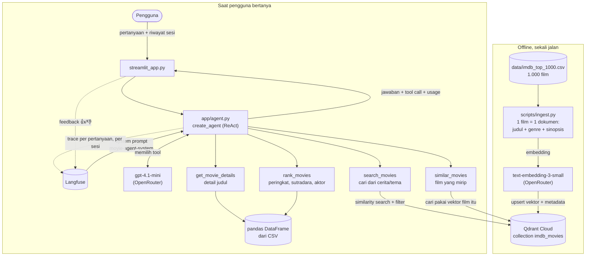

# Rakfilm

Asisten rekomendasi film berbasis **agentic RAG** untuk dataset **IMDB Top 1000**. Ceritakan film yang kamu ingat ("pencuri yang masuk ke mimpi orang"), minta yang mirip dengan film favoritmu, atau minta daftar terbaik per genre, sutradara, dan aktor. Agent memilih sendiri tool yang tepat, lalu menjawab dalam bahasa Indonesia dengan kartu poster yang bisa dibuka.

Capstone Module 3, Purwadhika JCAIEH.

- **App:** https://imdb-movie-assistant.streamlit.app/
- **Stack wajib:** Qdrant Cloud (vector database), Langfuse (prompt + tracing), Streamlit (UI + deploy)
- **LLM:** `openai/gpt-4.1-mini` lewat OpenRouter · **Embedding:** `openai/text-embedding-3-small` (1536 dimensi)
- **Agent:** LangChain `create_agent` (loop ReAct)

## Fitur

- **Chat dengan ingatan sesi:** pertanyaan lanjutan ("yang paling lama durasinya?") memahami jawaban sebelumnya.
- **Tool call dan dokumen terlihat:** setiap jawaban menampilkan tool yang dipanggil beserta argumennya, dokumen film yang di-retrieve dari Qdrant, dan skor kemiripannya.
- **Usage per jawaban dan per sesi:** token input/output dan biaya dalam USD dan Rupiah (kurs harian ECB).
- **Kartu film di dalam jawaban:** poster bisa diklik untuk membuka panel detail berisi sinopsis berbahasa Indonesia, fakta menarik, pemain dan sutradara yang bisa diklik, film mirip, dan tautan "Tonton di mana".
- **Muat lebih banyak:** hasil pencarian dan peringkat bisa dilanjutkan tanpa bertanya ulang.
- **Rak + IG story:** simpan sampai 4 film ke rak, lalu buat gambar story 1080×1920 dengan headline dari LLM dan tema warna sesuai genre.
- **Feedback 👍/👎:** tersimpan sebagai score di trace Langfuse, bisa dibandingkan per versi prompt.
- **Tema terang dan gelap.**

## Cara kerja



**Kenapa empat tool, dua jenis sumber:**
- **RAG (Qdrant):** pertanyaan berbasis makna, misalnya "film tentang kesepian di luar angkasa", butuh pencarian vektor.
- **Non-RAG (pandas):** pertanyaan pasti, misalnya "5 film horor dengan rating tertinggi" atau "film Christopher Nolan", lebih akurat kalau disaring dan diurutkan langsung dari tabel. Pencarian vektor tidak bisa mengurutkan berdasarkan rating.

Agent menulis query `search_movies` dalam bahasa Inggris (sinopsis di dataset berbahasa Inggris), lalu menjawab dalam bahasa pengguna.

## Struktur repo

```
streamlit_app.py            UI: chat, kartu film, panel detail, rak, IG story, usage
app/
  config.py                 baca .env / Streamlit Secrets, buat klien LLM dan embedding
  agent.py                  agent + prompt dari Langfuse + tracing + feedback
  tools.py                  4 tool agent + fungsi "muat lebih banyak"
  data.py                   muat CSV ke DataFrame, fakta menarik
  movie_cards.py            komponen kartu poster (Streamlit Custom Components v2)
  story.py                  gambar IG story dengan Pillow
scripts/
  check_connections.py      cek OpenRouter, Qdrant, dan Langfuse sebelum ingest
  ingest.py                 CSV -> embedding -> Qdrant
  translate_overviews.py    terjemahkan 1.000 sinopsis ke bahasa Indonesia (sekali saja)
  make_logo.py              gambar logo Rakfilm
data/
  imdb_top_1000.csv         dataset
  overview_id.csv           sinopsis bahasa Indonesia, hasil translate_overviews.py
static/                     font (lisensi OFL) dan logo
.streamlit/config.toml      tema terang/gelap
notes/                      log keputusan desain, progres, penjelasan kode
```

## Dataset

[IMDB Dataset of Top 1000 Movies and TV Shows](https://www.kaggle.com/datasets/harshitshankhdhar/imdb-dataset-of-top-1000-movies-and-tv-shows) (Kaggle), 1.000 film rilis 1920–2020.

| Kolom | Isi |
|---|---|
| `Poster_Link` | URL poster dari IMDB |
| `Series_Title` | Judul film |
| `Released_Year` | Tahun rilis |
| `Certificate` | Sertifikat usia penonton |
| `Runtime` | Durasi |
| `Genre` | Genre, bisa lebih dari satu |
| `IMDB_Rating` | Rating IMDB |
| `Overview` | Sinopsis singkat (satu-dua kalimat) |
| `Meta_score` | Skor Metacritic |
| `Director` | Sutradara |
| `Star1`–`Star4` | Empat pemeran utama |
| `No_of_votes` | Jumlah vote di IMDB |
| `Gross` | Pendapatan kotor (USD) |

Yang di-embed per film: `judul. genre. sinopsis`. Semua kolom lain disimpan sebagai metadata di Qdrant dan dipakai untuk filter genre dan tahun. Dataset hanya berisi sinopsis singkat, jadi agent bisa menemukan film dari premis ceritanya, tapi tidak dari adegan atau kutipan spesifik.

## Instalasi

Butuh Python 3.11 atau lebih baru (app di Streamlit Cloud memakai 3.14).

```bash
git clone https://github.com/reinerrekado/purwadhika-capstone-3.git
cd purwadhika-capstone-3
python -m venv .venv
.venv\Scripts\activate          # Windows
# source .venv/bin/activate     # macOS / Linux
pip install -r requirements.txt
```

## Variabel lingkungan

Salin `.env.example` menjadi `.env`, lalu isi. File `.env` tidak pernah di-commit (ada di `.gitignore`). Di Streamlit Cloud, isi yang sama dimasukkan ke **Settings → Secrets**.

| Variabel | Isi |
|---|---|
| `OPENROUTER_API_KEY` | API key dari https://openrouter.ai/keys |
| `LLM_MODEL` | `openai/gpt-4.1-mini` |
| `EMBEDDING_MODEL` | `openai/text-embedding-3-small` |
| `QDRANT_URL` | URL cluster Qdrant Cloud |
| `QDRANT_API_KEY` | API key Qdrant |
| `QDRANT_COLLECTION` | `imdb_movies` |
| `LANGFUSE_PUBLIC_KEY` | Public key project Langfuse |
| `LANGFUSE_SECRET_KEY` | Secret key project Langfuse |
| `LANGFUSE_HOST` | `https://cloud.langfuse.com` |

## Prompt di Langfuse

Tidak ada prompt yang ditulis di kode. Semuanya diambil dari Langfuse dengan label `production`.

| Nama prompt | Dipakai oleh | Wajib? |
|---|---|---|
| `movie-agent-system` | system prompt agent (`app/agent.py`) | Ya |
| `story-headline` | headline IG story (`app/story.py`) | Tidak, tanpa prompt ini headline dibuat dari aturan cadangan |
| `overview-translator` | `scripts/translate_overviews.py` | Tidak, hasil terjemahannya sudah ada di `data/overview_id.csv` |

Prompt diambil ulang setiap 60 detik, jadi versi baru di Langfuse langsung terpakai tanpa restart app.

## Menjalankan

```bash
python scripts/check_connections.py   # 1. pastikan ketiga layanan terhubung
python -m scripts.ingest              # 2. isi Qdrant (cukup sekali)
streamlit run streamlit_app.py        # 3. buka http://localhost:8501
```

Langkah 2 aman diulang: collection dibuat ulang dari nol, jadi data tidak tergandakan.

## Contoh pertanyaan

| Pertanyaan | Tool yang dipakai agent |
|---|---|
| film tentang pencuri yang masuk ke mimpi orang | `search_movies` |
| film sedih tentang persahabatan di penjara | `search_movies` |
| film yang mirip Interstellar | `similar_movies` |
| siapa sutradara Parasite dan berapa ratingnya? | `get_movie_details` |
| bandingkan The Godfather dan Goodfellas | `get_movie_details` |
| 5 film horor terbaik | `rank_movies` |
| film Christopher Nolan | `rank_movies` |
| film Tom Hanks yang paling lama durasinya | `rank_movies` |
| Star Wars mana yang paling bagus? | `rank_movies` |
| ada berapa film Hayao Miyazaki tahun 2000-an? | `rank_movies` |

Pertanyaan lanjutan juga bisa, misalnya setelah "film Christopher Nolan" lalu tanya "yang mana paling lama?".
